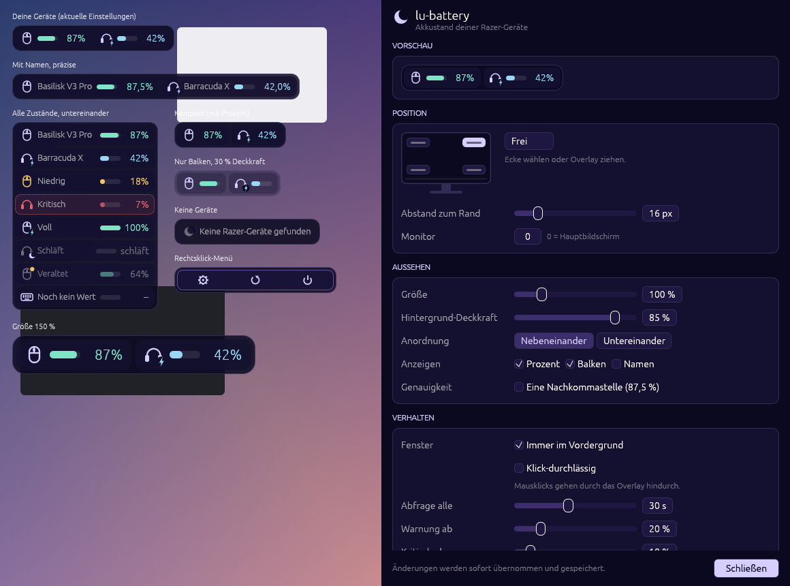

# lu-battery — Design

Theme: lu-minal **Moon**. Code: `src/ui/` (`theme.rs` Palette + egui-Visuals,
`widgets.rs` gezeichnete Glyphen, `mod.rs` Overlay + Einstellungen).
Vorschau mit Fake-Geräten: `cargo run --example preview`.

## Farben

| Rolle | Wert | Verwendung |
|---|---|---|
| bg | `#0b0920` | Overlay-Hintergrund (× Deckkraft), Fenster |
| surface | `#141030` | Geräte-Zelle (× Deckkraft), Abschnitte |
| surfaceFocus | `#1d1742` | Eingabefelder, Buttons |
| popover | `#181338` | Rechtsklick-Menü, Fenster |
| border | surface + 18 % `#b9aefb` | 1-px-Rand |
| text / muted / faint | `#fbf7f0` / surface + 62 % / + 40 % text | Text, Namen, Hinweise, gedimmt |
| accent | `#d6cffd` | Geräte-Icons, Abschnittstitel, Primär-Button |
| accent2 | `#9ad7f5` | lädt (Balken, Prozent, Blitz) |
| success | `#7fe3c6` | Akku ok, voll |
| warning | `#f3c766` | ≤ Warn-Schwelle, Hinweis „veraltet“ |
| error | `#e5626b` | ≤ Kritisch-Schwelle (pulsiert), Verbindungsfehler |
| selection | `#3b2e6b` | Auswahl, Hover |
| outline | `#5b4f9e` | Hover-Rand, Menü-Rand |

## Overlay-Maße (Scale 1.0, logical px)

Alle Maße × `settings.scale` (0.75–2.0). Die Skalierung wendet `overlay()` selbst an,
kein `zoom_factor`, damit das Einstellungsfenster normal groß bleibt.
Der Rückgabewert ist bereits skaliert.

| Element | Wert |
|---|---|
| Außenrand / Abstand zwischen Zellen | 4 |
| Container-Radius / Zell-Radius | 12 / 8 |
| Zellhöhe | 30 |
| Innenabstand Zelle (x) | 9 |
| Icon | 17 × 17 |
| Balken | 30 × 7, voll abgerundet |
| Schrift Prozent / Name | 14 / 12.5 (proportional) |

Eine Zelle: `[Icon] [Name]? … [Balken]? [Prozent]?`. Balken und Prozent sind rechtsbündig,
damit untereinander gestapelte Zellen Spalten bilden. Für den Prozenttext ist immer die
Breite von „100%“ (bzw. „100,0%“) reserviert. So springt die Fenstergröße nicht, wenn sich
der Wert ändert.

Deckkraft (`opacity`) wirkt nur auf Container, Rand und Zellflächen. Text und Icons bleiben
voll deckend. Bei 0 % schweben nur Icons, Balken und Zahlen über dem Desktop.

## Zustände

| Zustand | Darstellung |
|---|---|
| ok (> Warn-Schwelle) | Balken + Prozent mint, Icon lavendel |
| niedrig (≤ `low_threshold`) | Balken, Prozent und Icon warning-gelb |
| kritisch (≤ `critical_threshold`) | error-rot, die Zelle bekommt einen roten Rand und Hauch, der sanft pulsiert (1,6 s). Nur dann wird alle 50 ms neu gezeichnet |
| lädt | Balken und Prozent accent2, Blitz-Badge unten rechts am Icon |
| voll (am Kabel) | mint, Blitz-Badge in mint |
| schläft (`Link::Asleep`) | alles faint, Text „schläft“, leerer Balken, Mond-Badge |
| veraltet (`Link::Error`) | letzter Wert gedimmt (Farbe 50 % zur Fläche gemischt), gelber Punkt oben rechts am Icon |
| kein Wert | „–“ in muted, leerer Balken |
| keine Geräte | Mond + „Keine Razer-Geräte gefunden“ (bzw. „Alle Geräte ausgeblendet“) |

Prozent: gerundet („87%“) oder mit `precise_percent` eine Nachkommastelle mit deutschem
Komma („87,5%“). Der Wert ist immer `raw / raw_max` vom Gerät.

## Interaktion

- **Ziehen** (Primärtaste) auf dem Overlay → `UiAction::StartDrag`
- **Doppelklick** → `OpenSettings`
- **Rechtsklick** → Menü **im** Overlay: Einstellungen (Zahnrad), Aktualisieren
  (Pfeil), Beenden (Power) → `OpenSettings` / `RefreshNow` / `Quit`. Ein egui-Popup
  würde vom kleinen Overlay-Fenster abgeschnitten. Daher legt sich das Menü über
  die Zellen, mit Beschriftung, wenn Platz ist. Es schließt sich bei Klick daneben,
  Esc, erneutem Rechtsklick oder wenn die Maus das Overlay verlässt.

## Einstellungsfenster

Abschnitte als abgerundete surface-Karten mit lavendelfarbenem Titel in Großbuchstaben:
**Vorschau** (Live-Overlay), **Position** (Mini-Bildschirm mit 4 klickbaren Ecken +
„Frei“, Abstand, Monitor), **Aussehen**, **Verhalten** (Hinweis bei Klick-Durchlässigkeit
in warning), **Geräte** (sichtbar-Checkbox, Icon, Name, Typ · ID, `xx,x% · raw/raw_max`,
Ladestatus, Link als farbige Pille, „Jetzt aktualisieren“). Fußleiste mit „Schließen“.
Jede Änderung → `SettingsChanged` (Vergleich vorher/nachher). Warn- und Kritisch-Schwelle
halten sich gegenseitig konsistent (kritisch ≤ warn).
Empfohlene Fenstergröße: ca. 600 × 760.

## App-Icon

`assets/make_icon.py` (nur Python-Standardbibliothek) erzeugt `icon.ico` (16/32/48/256) und
`icon.png` (256) plus `icon-{16,32,48,256}.png` (z. B. fürs Tray). Motiv: lavendelfarbene
Mondsichel, in ihrer Öffnung ein Akku in mint, auf abgerundetem Moon-Hintergrund mit
outline-Rand. Gezeichnet über Distanzfunktionen mit 4× Supersampling.

## Screenshots

`LU_PREVIEW_SHOT=target/shot.bmp cargo run --example preview` rendert einen Frame, speichert ihn
und beendet sich. Dabei wird nur das eigene Fenster erfasst, nicht der Bildschirm.
`LU_PREVIEW_SETTINGS_OFFSET=760` schiebt das Einstellungsfenster nach oben, um den
unteren Teil zu sehen. In PNG umwandeln mit
`powershell -File examples/bmp2png.ps1 in.bmp out.png`.
